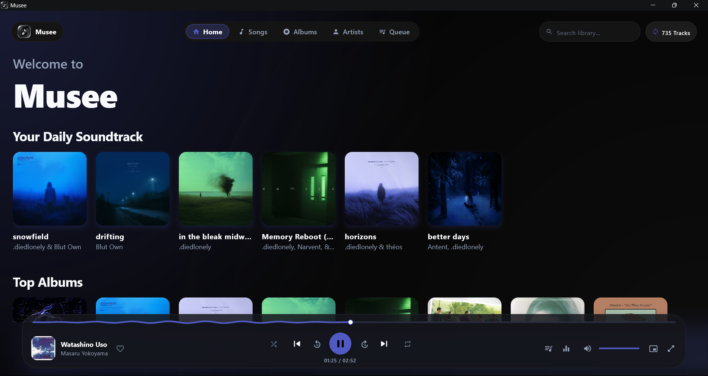
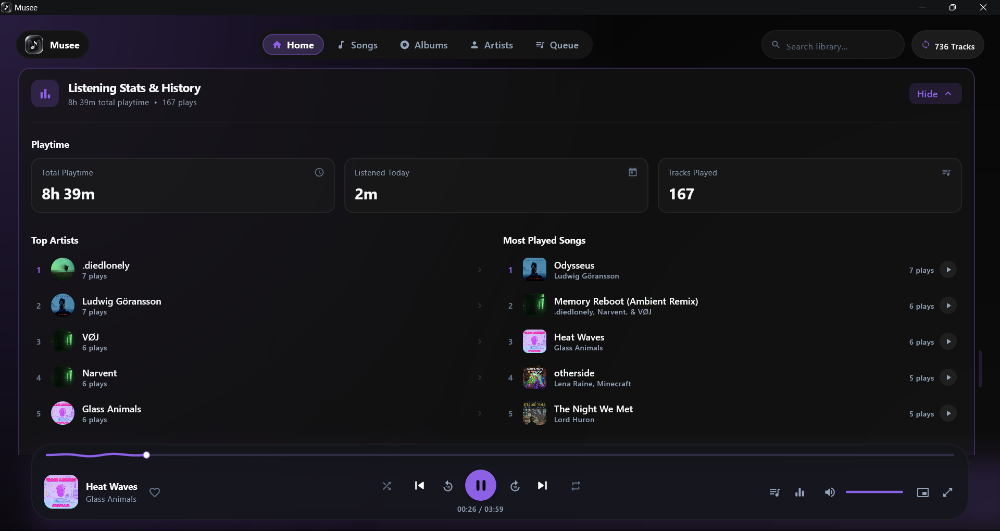
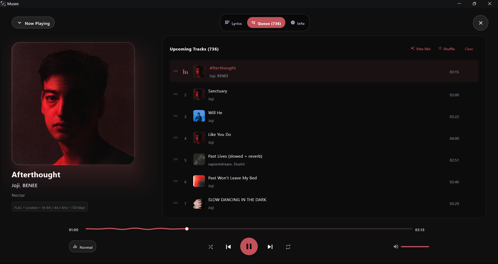
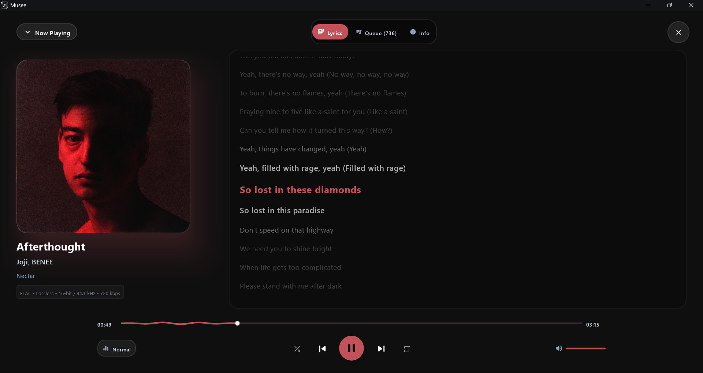
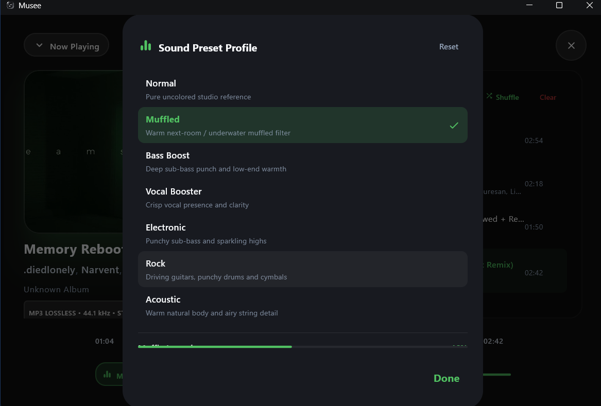
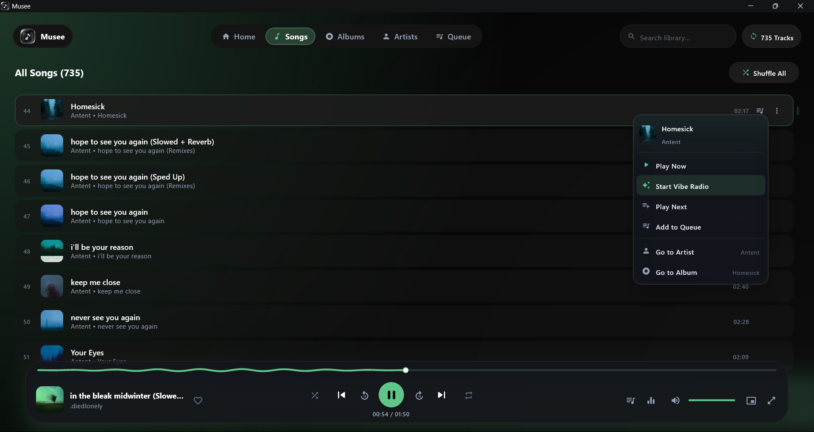

# Musee
**A fast, modern offline music player for Windows.**

[Download Installer (.msi)](installer/Musee-1.0.0.msi) &nbsp;•&nbsp; [Download Portable (.zip)](installer/Musee-1.0.0-Portable-Windows-x64.zip) &nbsp;•&nbsp; [Screenshots](#-screenshots)

 

---

## Why Musee?

Most desktop music players today fall into two extremes: bloated web wrappers that eat hundreds of megabytes of RAM just to idle, or legacy players from 2005 that feel completely out of place on Windows 11.

**Musee** is built to be the music player you actually want to keep open on your desktop:

- **Instant & Lightweight**: Opens in a split second, stays smooth at 60 FPS, and sips laptop battery.
- **Dynamic Artwork Palette**: The background gradients and UI accents gently shift in real time to match the cover art of whatever song is playing.
- **Smart Offline Queue**: Ever hit play on one song and wish your player would just keep the vibe going? Musee looks at tempo, mood, and artist flow across your library to queue up the next tracks automatically — no internet connection required.
- **Sound Profiles**: One-click audio enhancements tuned for headphones and desktop speakers — punchy Bass Boost, a relaxed lo-fi Muffled curve, vocal clarity, and bit-perfect neutral.
- **Synchronized Lyrics**: Automatic karaoke-style scrolling lyrics whenever `.lrc` files or embedded lyrics are present.
- **Local Listening Analytics**: Track your total playtime, most played tracks, top artists, and listening routines. Everything stays strictly offline on your own machine.
- **Windows Integration**: Global keyboard media keys (`Play`, `Pause`, `Next`, `Prev`) work while gaming or running in the background.

---

## Download

Musee runs on 64-bit Windows 10 and Windows 11. No Java or external dependencies required — everything is self-contained.

| Edition | Format | Size | Details | Download |
| :--- | :---: | :---: | :--- | :---: |
| **Windows Installer** | `.msi` | ~102 MB | Recommended. Creates Desktop & Start Menu shortcuts, clean Windows uninstaller. | [**Download .msi**](installer/Musee-1.0.0.msi) |
| **Portable Edition** | `.zip` | ~100 MB | Zero-install archive. Extract anywhere and launch `Musee.exe`. | [**Download .zip**](installer/Musee-1.0.0-Portable-Windows-x64.zip) |

### Getting Started:
1. Download [**`Musee-1.0.0.msi`**](installer/Musee-1.0.0.msi) (or grab the portable `.zip`).
2. Run the installer and follow the quick setup wizard.
3. Launch Musee and let it scan your local music library.

---

## 📸 Screenshots

### Home & Daily Soundtrack
*Fluid ambient theme matching the currently playing album artwork.*

### Listening Habits & Offline Analytics
*Discreet collapsible hub tracking your total playtime, top artists, and favorite tracks.*

### Immersive Player & Smart Queue
*Fullscreen player with mood-seeded queue recommendations.*

### Synchronized Lyrics
*Real-time line-by-line autoscrolling lyrics.*

### Tuned Audio Presets
*Smooth equalization with zero clicks, pops, or digital clipping.*

### Songs Library & Quick Actions
*Fast searchable library with quick vibe radio and queue options.*

---

## Supported Formats

- **FLAC** (Lossless up to 24-bit / 96 kHz)
- **MP3** (ID3v1, ID3v2.3, ID3v2.4 with embedded album art)
- **WAV** (Uncompressed PCM)
- **AAC / M4A**
- **OGG Vorbis**

---

## System Requirements

- **OS**: Windows 10 (version 1903 or later) or Windows 11 (64-bit)
- **Memory**: 4 GB RAM minimum
- **Disk Space**: ~150 MB free space
- **Runtime**: Self-contained (OpenJDK runtime bundled)

---

## 🔒 License & Terms

**Copyright © 2026 Musee. All Rights Reserved.**

Musee is proprietary software provided free of charge strictly for personal use on your own devices.
- **No Redistribution**: You may not re-upload, mirror, resell, bundle, or redistribute the installers (`.msi`), portable packages (`.zip`), or binary files on any other website or service.
- **Intellectual Property**: All trademarks, graphics, branding, and audio algorithms are the exclusive property of the author.

Please see the [LICENSE](LICENSE) file for complete terms.
